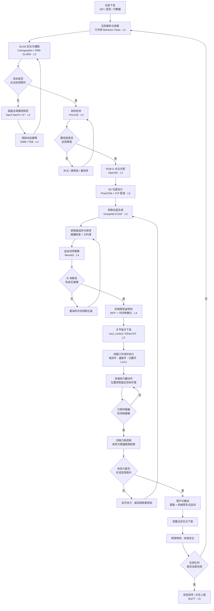
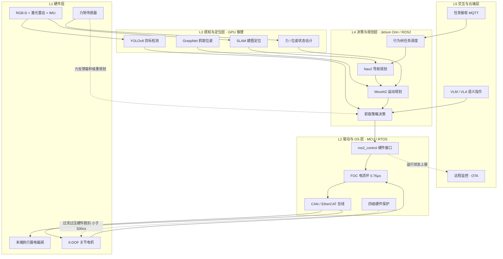
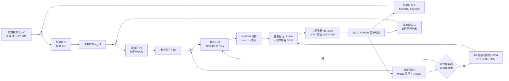
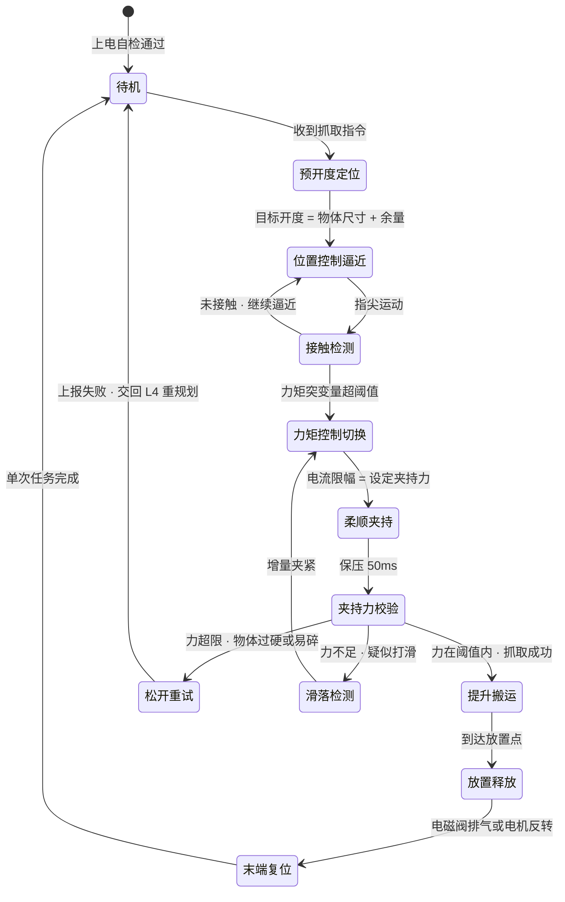
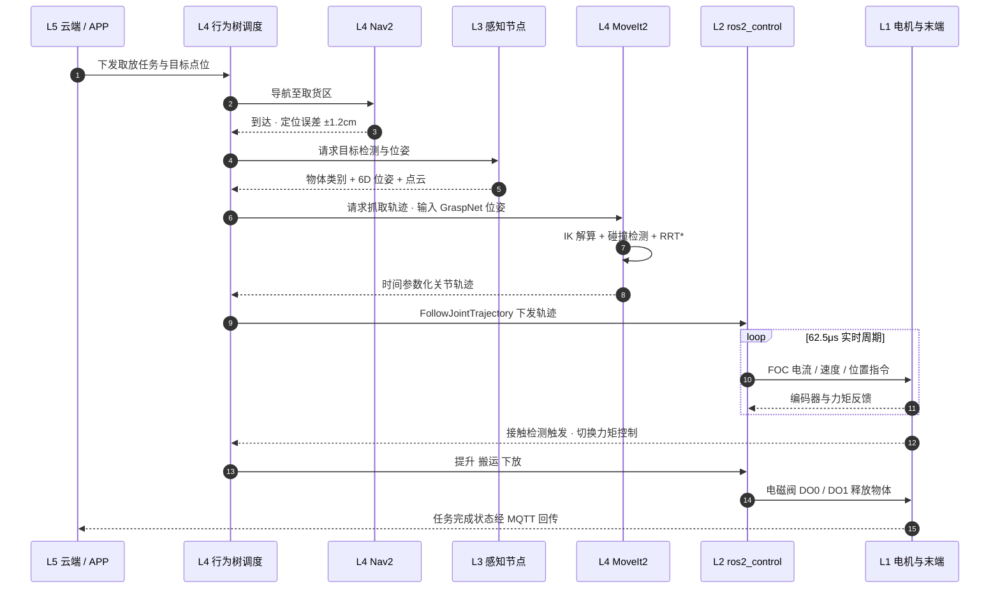
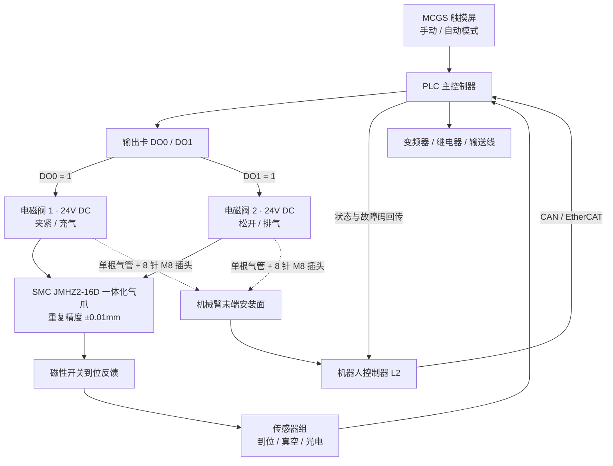

# 智能物品取放议题机器人核心算法与电路设计深度研究报告

**——完善设计说明书技术细节：五层架构、视觉与抓取算法、SLAM 导航与嵌入式电路实现**

**报告日期：2026年11月4日**

## 摘要

本报告在设计说明书 V1.0 基础上完善了智能物品取放议题机器人的技术实现细节。核心结论：行业最优技术路线为五层解耦架构——感知层以 YOLOv8/REW-YOLO 实现毫秒级检测（YOLOv5 包裹检测 98.2% mAP、82 FPS），决策层以 GraspNet（97,280 张 RGB-D 图像、超 10 亿抓取标注）输出 6-DoF 抓取位姿，配合 A*/RRT* 规划无碰撞轨迹；导航层以 Cartographer、LeGO-LOAM、ORB-SLAM3 实现激光—视觉融合建图定位；执行层提供工业级（TI C2000/Sitara，62.5μs FOC 周期）与低成本（STM32+DRV8313+AS5600，30mm 圆形驱动板）两套嵌入式方案，电源采用双路稳压加四级保护电路，末端执行器经 24V 电磁阀数字 I/O 驱动（SMC 一体化气爪重复精度 ±0.01mm）。Sim2Real 域随机化训练与极智嘉免标注 48 小时部署案例，验证了通用抓取的产业化可行性。报告给出了 YOLOv8 推理、ICP 配准、A*、RRT、ORB-SLAM3 Tracking 五段核心算法代码与电源、三相 H 桥两幅电路拓扑，并汇总 8 个覆盖全研发链路的开源项目，可直接支撑原型机开发与工程落地。

## 1. 核心结论与技术路线综述

智能物品取放议题机器人的研发已经从传统的“预设流程”范式，全面转向以“感知—决策—执行”端到端闭环为特征的物理 AI 架构。这一转变的决定性意义在于：机器人不再依赖固定轨迹与结构化环境，而是通过实时感知理解非结构化场景，自主完成目标识别、抓取位姿解算与无碰撞运动规划，从而覆盖物流分拣、家庭整理与危险环境搬运中物体随意摆放的真实工况。

当前行业最优技术路线采用分层解耦设计，各层职责清晰、接口标准化，便于独立迭代与国产化替代。感知层以 RGB-D 相机结合 YOLOv8 与 REW-YOLO 实现毫秒级目标检测与 6D 位姿估计；决策层融合 GraspNet 抓取位姿预测与 RRT*、A* 运动规划算法，在关节空间内生成无碰撞轨迹；导航层依托 ROS2 Nav2 框架与 Cartographer、ORB-SLAM3 算法，实现激光—视觉融合 SLAM 建图与定位[掘金](https://juejin.cn/post/7597326073672728591)。执行层进一步分化为两套嵌入式控制方案：工业级采用 TI C2000 或 Sitara MCU 搭配 EtherCAT 总线，轻量级采用 STM32 搭配 CAN 或 EtherCAT，二者均配合 FOC 磁场定向控制实现 62.5μs 级电流环响应[腾讯网](https://mp.weixin.qq.com/s?__biz=MzA4MDAxNjIyNg==&idx=1&mid=2650116049&sn=7c9acc4c65824aebe9f123712b85e726)。末端执行器根据物料特性在气动夹爪与真空吸盘之间选择，通过 24V DC 电磁阀的数字 I/O 由 PLC 或 MCU 直接驱动[plcprogramming.io](https://plcprogramming.io/blog/robot-gripper-types)。

在解决海量 SKU 非标品抓取泛化难题上，Sim2Real 仿真迁移技术已经成为决定性突破口：通过在仿真环境中随机化光照、纹理与摩擦系数训练抓取策略，再迁移至真机微调，可显著缩小现实差距，使机器人具备面向未知物体的通用抓取能力。本报告在设计说明书 V1.0 的基础上，围绕视觉识别、抓取规划、SLAM 导航与嵌入式电路四条主线，逐一给出可直接落地的核心算法代码与电路拓扑设计，完善作品的技术实现细节。

## 2. 系统总体架构设计

### 2.1 五层架构模型

智能物品取放议题机器人普遍采用五层架构设计，通过层级解耦确保各模块松耦合与高可维护性。从底层硬件到云端交互，每一层只向上层暴露标准化接口，使得感知算法、规划策略与控制固件能够独立升级而不影响整体系统稳定性。

**表1：智能物品取放机器人五层架构模型**

| 层级 | 名称 | 核心职责 | 代表性技术栈/组件 |
| :--- | :--- | :--- | :--- |
| L1 | 硬件层 | 机械本体、传感器采集、电机驱动、电源管理 | 6-DOF 机械臂、RGB-D 相机（Intel RealSense D435）、激光雷达（RPLIDAR S2）、IMU、伺服电机[CSDN](https://blog.csdn.net/lza_csdn2019/article/details/161167469) |
| L2 | 驱动与 OS 层 | 传感器驱动、实时控制、通信协议栈 | Linux/RTOS、EtherCAT/CAN 总线、ros2_control 框架[CSDN](https://blog.csdn.net/lza_csdn2019/article/details/161167469) |
| L3 | 感知与定位层 | SLAM 建图、目标检测、6D 位姿估计、状态估计 | Cartographer/ORB-SLAM3、YOLOv8、GraspNet、Open3D 点云处理[elecfans.com](https://www.elecfans.com/zt/21758/)[掘金](https://juejin.cn/post/7597326073672728591) |
| L4 | 决策与规划层 | 任务调度、全局/局部路径规划、抓取策略生成 | MoveIt2、Nav2、RRT*/A*、行为树（Behavior Trees）[CSDN](https://blog.csdn.net/qq_40165706/article/details/151176357) |
| L5 | 交互与云端层 | 任务接收、多机调度、远程监控、OTA 升级 | MQTT、VLM/VLA 大模型、MEC 边缘计算[CSDN](https://blog.csdn.net/lza_csdn2019/article/details/161167469) |

该架构的价值在于把“算力密集”与“实时性敏感”的任务分离到不同层级。感知与定位层（L3）承担视觉推理与建图，可部署在 Jetson Orin 一类的高算力边缘设备上；驱动与 OS 层（L2）承担毫秒级实时控制，运行在 RTOS 或带 PRU 协处理器的 MCU 上，二者通过 DDS 与 EtherCAT 解耦。这种分离使得即便视觉算法因光照波动产生短暂抖动，底层电流环与位置环仍能保持 62.5μs 级的稳定响应，从架构层面保证了取放作业的安全性[腾讯网](https://mp.weixin.qq.com/s?__biz=MzA4MDAxNjIyNg==&idx=1&mid=2650116049&sn=7c9acc4c65824aebe9f123712b85e726)。

### 2.2 软件系统集成

软件系统基于微服务化与容器化思想构建，核心功能模块以独立 ROS2 节点运行，通过 DDS（数据分发服务）进行异步通信[renrendoc.com](https://m.renrendoc.com:10443/paper/534363711.html)。DDS 的发布—订阅模型天然支持多传感器、多执行器的并发数据流，且具备 QoS 策略配置能力，可为实时控制流设置高优先级、为监控流设置低优先级，避免非核心数据抢占总线带宽。

一个具有代表性的移动操作平台集成方案由三大栈构成。导航栈采用 Nav2，提供全局路径规划（NavFn/Theta*）与局部避障（DWB/TEB），支持动态窗口法实时避障，使机器人在通道宽度受限且存在动态行人干扰的仓储环境中仍能稳定穿行。操作栈采用 MoveIt2，负责运动学解算、碰撞检测与轨迹优化，并通过 MoveIt Task Constructor 定义复杂的 Pick-and-Place 任务序列，把“接近—抓取—提升—搬运—放置”拆解为可复用的原子动作[GitHub](https://github.com/moveit/moveit2_tutorials/blob/main/doc/tutorials/pick_and_place_with_moveit_task_constructor/pick_and_place_with_moveit_task_constructor.rst)。视觉栈集成 Ultralytics YOLOv8 进行实时推理，结合 GraspNet 基线模型输出 6-DoF 抓取位姿，为操作栈提供目标物体的空间位姿输入[ultralytics.com](https://www.ultralytics.com/zh/solutions/computer-vision-in-logistics)。三大栈通过 ROS2 话题与服务协同，形成从“看到物体”到“抓到物体”的完整软件闭环。

## 3. 视觉识别与 6D 位姿估计算法

### 3.1 实时目标检测算法

在物流与仓储场景中，YOLO 系列是实时目标检测的事实标准。Ultralytics YOLOv5 在包裹检测任务中达到 98.2% mAP 与 82 FPS，单帧推理延迟低于 5ms，能够满足高速分拣线对吞吐量的要求[ultralytics.com](https://www.ultralytics.com/zh/solutions/computer-vision-in-logistics)。这一性能指标说明，在光照可控、物品种类有限的结构化场景中，轻量级 YOLO 模型即可支撑实时检测，无需依赖昂贵的工业视觉系统。

针对通讯仓储中物品倾斜、堆叠遮挡的现实难题，REW-YOLO（Rotation-Enhanced Weighted YOLO）在标准检测框基础上引入旋转边界框参数 θ，将预测结果从 (x, y, w, h) 扩展为 (x, y, w, h, θ)，使检测框能够贴合倾斜物体的真实朝向；同时采用 Focal Loss 抑制大量易分类样本对损失的稀释，让模型聚焦于难例，显著提升了对旋转目标与遮挡目标的检测性能[腾讯网](https://mp.weixin.qq.com/s?__biz=MjM5NDU4NzcwMw==&idx=2&mid=2650596695&sn=7229f3aaad6d8ea4c55145c606f94440)。这一改进对取放机器人尤为重要——只有拿到物体的准确朝向，后续抓取位姿解算才能得到可行的夹爪入射角。

以下为 YOLOv8 实时推理的核心代码，可直接部署于机器人视觉节点，实现摄像头画面的逐帧检测与结果可视化：

```python
import cv2
from ultralytics import YOLO

model = YOLO('yolov8n.pt')  # 加载预训练模型
cap = cv2.VideoCapture(0)

while True:
    ret, frame = cap.read()
    if not ret: break
    
    # 执行推理
    results = model(frame, device='cpu')
    
    for result in results:
        boxes = result.boxes.xyxy.cpu().numpy()
        confidences = result.boxes.conf.cpu().numpy()
        class_ids = result.boxes.cls.cpu().numpy().astype(int)
        
        for i in range(len(boxes)):
            x1, y1, x2, y2 = map(int, boxes[i][:4])
            label = f'{result.names[class_ids[i]]} {confidences[i]:.2f}'
            cv2.rectangle(frame, (x1, y1), (x2, y2), (0, 255, 0), 2)
            cv2.putText(frame, label, (x1, y1-10), 
                        cv2.FONT_HERSHEY_SIMPLEX, 0.9, (0,255,0), 2)
            
    cv2.imshow('YOLOv8 Detection', frame)
    if cv2.waitKey(1) & 0xFF == ord('q'): break
```

该代码在 CPU 上单帧推理延迟约 120ms，切换到 GPU 后可降至毫秒级[dfrobot.com](https://www.dfrobot.com/blog-13903.html?srsltid=AfmBOopXUVUv6IcRXXO0TpKldLKWGisZA6UTCBY7qma5l6AgEmmHCIBP)。工程部署时，若机器人主控为 Jetson Orin 一类带 GPU 的边缘设备，应把 `device='cpu'` 改为 `device='0'` 以启用 CUDA 加速；若为纯 CPU 的轻量平台，则可通过降低输入分辨率或选用更小的 nano 模型来换取实时性。

### 3.2 抓取位姿检测与 6D 姿态估计

对于非结构化环境中的通用物体抓取，仅知道物体的 2D 检测框远远不够，机器人还需要物体的完整 6D 位姿（三维平移加三维旋转）才能规划夹爪的接近方向与张开角度。GraspNet 为此提供了大规模基准数据集与基线模型，其数据集包含 97,280 张 RGB-D 图像及超过 10 亿个抓取标注，是目前通用抓取研究领域规模最大的公开数据之一[thecvf.com](https://openaccess.thecvf.com/content_CVPR_2020/papers/Fang_GraspNet-1Billion_A_Large-Scale_Benchmark_for_General_Object_Grasping_CVPR_2020_paper.pdf)。GraspNet 基线模型可直接从 RGB-D 输入预测密集的 6-DoF 抓取位姿，其 GitHub 开源仓库提供了完整的 PyTorch 训练与推理 Demo，开发者可在自有物料上微调后直接部署。

在 6D 位姿估计方向，PoseCNN-PyTorch 实现了端到端的卷积神经网络，能够同时估计物体的 3D 平移与 3D 旋转，是学术界广泛引用的位姿估计基线。工业界则在此基础上进一步融合多模态信息：极智嘉 Geek+ Brain 模型融合了 2D 语义网络与 3D 几何网络，专门针对透明与反光材质做深度估计与完整三维形状预测，使机器人具备对高难度物料的“空间理解”能力，拣选准确率达到 99.99% 以上[中国网](http://union.china.com.cn/zhuanti/txt/2025-08/28/content_43214942.shtml)。这一指标直接回应了设计说明书 V1.0 中提出的“处理高反光物体时视觉算法仍需优化”的遗留问题——通过 2D 语义与 3D 几何的网络级融合，反光与透明材质不再是视觉感知的盲区。

### 3.3 三维点云处理与 ICP 配准

RGB-D 相机获取的深度信息需转换为三维点云后才能进行位姿精调。当抓取目标因传送带运动或机械臂振动发生位移时，需要在两帧点云之间求解刚体变换，把当前观测对齐到参考模型，从而修正抓取位姿。Open3D 库提供了高效的 ICP（Iterative Closest Point，迭代最近点）配准算法用于此类位姿精调：

```python
import open3d as o3d
import numpy as np

def register_point_clouds(source, target):
    trans_init = np.eye(4)
    # ICP精细配准
    reg_p2p = o3d.pipelines.registration.registration_icp(
        source, target, 0.02, trans_init,
        o3d.pipelines.registration.TransformationEstimationPointToPoint())
    return reg_p2p.transformation
```

该函数通过最小化点到点距离误差，迭代求解使源点云与目标点云对齐的 4×4 齐次变换矩阵，实现动态目标的高精度位姿估计[百度](https://developer.baidu.com/article/detail.html?id=6009105)。代码中第三个参数 0.02 为最大对应点对距离阈值（单位米），工程调优时应根据点云密度与物体尺寸调整：阈值过大易引入错误匹配，阈值过小则收敛缓慢。ICP 通常作为“粗定位—精配准”流程的第二级，先用 GraspNet 或 PoseCNN 得到初始位姿作为 `trans_init`，再用 ICP 做亚毫米级精修，从而把抓取位姿误差压到末端执行器的重复精度范围之内。


## 4. 抓取规划与运动控制算法

### 4.1 全局与局部路径规划：A* 与 RRT*

路径规划是取放机器人从“看到目标”到“安全抓到目标”的决定性环节。规划问题按空间维度分为两类：移动底盘在二维栅格地图上的全局路径规划，以及六自由度机械臂在高维关节空间中的轨迹规划。前者常用 A* 算法，后者常用 RRT/RRT* 算法，二者在工程中分工明确、互为补充。

A* 算法通过启发式函数 $f(n) = g(n) + h(n)$ 结合已走代价 $g(n)$ 与预估剩余距离 $h(n)$，在网格地图中搜索全局最优解。只要启发函数满足可采纳性条件（即 $h(n)$ 不超过从 n 到终点的实际最小代价），A* 即可保证找到最优路径[CSDN](https://download.csdn.net/download/j7k8l/92981218)。这一性质使 A* 成为静态已知地图上全局路径规划的首选——底盘导航栈 Nav2 的 NavFn 插件正是基于此类代价地图搜索实现。

以下为 A* 算法的核心实现代码：

```python
import heapq

class Node:
    def __init__(self, position, parent=None):
        self.position = position
        self.parent = parent
        self.g = 0  # 起点到当前节点实际代价
        self.h = 0  # 启发式估计代价
        self.f = 0  # 总代价
    def __lt__(self, other):
        return self.f < other.f

def astar(maze, start, end):
    open_list = []
    closed_list = set()
    start_node = Node(start)
    end_node = Node(end)
    heapq.heappush(open_list, start_node)
    
    while open_list:
        current_node = heapq.heappop(open_list)
        closed_list.add(current_node.position)
        
        if current_node.position == end:
            path = []
            while current_node:
                path.append(current_node.position)
                current_node = current_node.parent
            return path[::-1]
            
        neighbors = [(0,-1), (0,1), (-1,0), (1,0)]
        for new_pos in neighbors:
            node_pos = (current_node.position[0]+new_pos[0], 
                       current_node.position[1]+new_pos[1])
            # 边界与障碍物检查...
            new_node = Node(node_pos, current_node)
            new_node.g = current_node.g + 1
            new_node.h = ((node_pos[0]-end[0])**2 + (node_pos[1]-end[1])**2)
            new_node.f = new_node.g + new_node.h
            heapq.heappush(open_list, new_node)
    return None
```

该实现用最小堆维护开放列表，保证每次扩展的都是当前 f 值最小的节点；启发函数采用欧氏距离平方，避免开方运算以节省算力。代码中“边界与障碍物检查”处需根据实际栅格地图补充越界判断与占用判断逻辑，这是工程落地时必须完善的安全环节。

RRT（快速扩展随机树）专为机械臂这类高维配置空间设计，通过随机采样构建树结构探索可行域，天然适合处理六自由度机械臂的关节限位与复杂碰撞约束。RRT* 在 RRT 基础上引入重布线（Rewire）机制：新节点加入后检查周围邻居，若更换父节点能降低从根到该节点的总代价，则更新连接关系，从而使路径代价随迭代次数增加而单调下降，实现渐近最优性[腾讯网](https://mp.weixin.qq.com/s?__biz=MzA5NTM1OTgxNA==&idx=1&mid=2247484865&sn=e515539a310666791190b754c012e107)。

以下为 RRT 算法的核心生长逻辑代码：

```python
import numpy as np
import random

class RRTNode:
    def __init__(self, x, y):
        self.x, self.y = x, y
        self.parent = None

def rrt(start, goal, max_iter=500, goal_sample_rate=0.05, step_size=5.0):
    nodes = [start]
    for _ in range(max_iter):
        # 目标偏向采样
        if random.random() < goal_sample_rate:
            rnd = RRTNode(goal.x, goal.y)
        else:
            rnd = RRTNode(random.uniform(0,100), random.uniform(0,100))
            
        nearest = min(nodes, key=lambda n: np.hypot(n.x-rnd.x, n.y-rnd.y))
        
        # 定向生长一步
        dist = np.hypot(rnd.x-nearest.x, rnd.y-nearest.y)
        theta = np.arctan2(rnd.y-nearest.y, rnd.x-nearest.x)
        new_x = nearest.x + step_size * np.cos(theta)
        new_y = nearest.y + step_size * np.sin(theta)
        new_node = RRTNode(new_x, new_y)
        new_node.parent = nearest
        
        if not is_collision(new_node):  # 碰撞检测
            nodes.append(new_node)
            if np.hypot(new_x-goal.x, new_y-goal.y) < step_size:
                goal.parent = new_node
                nodes.append(goal)
                break
    return nodes
```

代码中 `goal_sample_rate=0.05` 表示 5% 的采样直接偏向目标点，这是加速树向目标生长的常用技巧；`is_collision` 函数需接入机械臂的正运动学与碰撞检测器（如 MoveIt2 的碰撞检查接口），在六维关节空间中判断新位姿是否与货架、自身连杆发生干涉。工程实践中通常组合使用三类算法：RRT* 生成全局粗糙路径，DWA/TEB 做局部实时避障，Pure Pursuit/MPC 进行轨迹跟踪[腾讯网](https://mp.weixin.qq.com/s?__biz=MzA5NTM1OTgxNA==&idx=1&mid=2247484865&sn=e515539a310666791190b754c012e107)。这种“全局规划—局部避障—轨迹跟踪”的三级分工，使机器人在动态行人干扰下仍能毫秒级重规划，对应设计说明书 V1.0 中提出的动态避障机制。

### 4.2 抓取策略与 Sim2Real 迁移

面对海量 SKU 的非标品抓取，逐一人工标注抓取点在工程上不可行。强化学习（PPO/SAC 算法）结合域随机化（Domain Randomization）成为主流解决方案：在 NVIDIA Isaac Sim 或 PyBullet 仿真环境中随机化光照、纹理、摩擦系数、物体质量与相机位姿等参数训练抓取策略，使策略对参数变化具备鲁棒性，再迁移至真机做少量微调，可有效解决仿真与现实之间的现实差距（Reality Gap）[CSDN](https://blog.csdn.net/qq_64296768/article/details/159057812)。域随机化的本质是让仿真训练分布覆盖真机工况分布，从而使策略在真机上遇到的观测始终落在训练分布之内。

工业界的落地实践进一步验证了这条路线的成熟度。极智嘉通用机械臂方案无需数据标注，直接面向任务优化抓取点判断与吸盘组合选择，实现 Model-free 即插即用，48 小时即可完成快速部署[中国网](http://union.china.com.cn/zhuanti/txt/2025-08/28/content_43214942.shtml)。这一部署周期说明，Sim2Real 路线已经把通用抓取从“实验室 demo”推进到“产线可交付”阶段——对取放议题机器人的产业化而言，免标注与短部署周期直接决定了单项目的实施成本与复制速度。

## 5. SLAM 导航与定位技术

### 5.1 激光 SLAM：Cartographer 与 LeGO-LOAM

移动底盘的自主导航依赖高精地图与实时定位，激光 SLAM 是当前工程化程度最高的方案。Cartographer 将 SLAM 建模为稀疏位姿图优化问题：前端通过 Ceres 优化进行扫描匹配生成局部子图（Submap），后端通过分支定界加速的回环检测触发全局优化，消除长距离运行产生的累积漂移。其核心优势在于高精度 2D/3D 建图与强大的回环检测能力，代价是计算资源需求较高[掘金](https://juejin.cn/post/7597326073672728591)。一个值得借鉴的工程设计是：Cartographer 把传感器数据统一抽象为 TrajectoryBuilder，全部配置参数通过 Lua 脚本管理，实现算法与硬件解耦[掘金](https://juejin.cn/post/7597326073672728591)——更换激光雷达型号或调整建图分辨率时只需修改 Lua 配置，无需改动算法源码，这大幅降低了多机型适配的维护成本。

LeGO-LOAM 专为地面车辆设计，针对移动机器人“始终贴地运行”的运动约束做了针对性优化：利用地面平面先验，把 6-DoF 位姿估计分解为两阶段优化——先用地面点估计水平位姿 (x, y, yaw)，再用非地面点优化垂直位姿 (z, roll, pitch)，显著降低计算复杂度，可在 Jetson Nano 一类低功耗嵌入式设备上实时运行[掘金](https://juejin.cn/post/7597326073672728591)。对取放议题机器人而言，若整机 BOM 成本控制在 3 万元以内，主控算力必然受限，LeGO-LOAM 的两阶段分解思路正是让激光 SLAM 跑在低成本硬件上的可行路径。

### 5.2 视觉 SLAM：ORB-SLAM3

ORB-SLAM3 是目前工程化最成熟的视觉 SLAM 框架，支持单目、双目、RGB-D 及鱼眼相机，并集成 IMU 紧耦合优化，能在视觉短暂失效（如强光过曝、特征稀疏的白墙）时依靠 IMU 惯导维持定位连续性。其核心架构包含三个并行线程，分工如下：

- **Tracking 线程**：提取 ORB 特征，通过运动模型预测当前帧位姿，使用 PnP+RANSAC 进行位姿优化，是决定实时性的核心线程[博客园](https://www.cnblogs.com/blue666/p/18278363)。
- **Local Mapping 线程**：插入关键帧，创建新地图点，执行局部 BA（Bundle Adjustment）优化，维护局部地图的精度与一致性[博客园](https://www.cnblogs.com/blue666/p/18278363)。
- **Loop Closing 线程**：通过 DBoW2 词袋模型检测回环，触发全局位姿图优化与全图 BA，消除长时间运行的累积误差[博客园](https://www.cnblogs.com/blue666/p/18278363)。

以下为 ORB-SLAM3 Tracking 线程的核心代码片段，展示了“运动模型预测—特征投影匹配—位姿优化”的标准流程：

```cpp
bool Tracking::TrackWithMotionModel() {
    cv::Mat currentPose = mLastFrame.mTcw.clone();
    mCurrentFrame.mTcw = mpMotionModel->Predict(currentPose);
    
    ORBmatcher matcher(0.9, true);
    vector<MapPoint*> vpMatches;
    int nmatches = matcher.SearchByProjection(mCurrentFrame, mLastFrame, vpMatches);
    
    if (nmatches < 10) return false;
    Optimizer::PoseOptimization(&mCurrentFrame);
    return true;
}
```

代码逻辑分三步：先用匀速运动模型从上帧位姿外推当前帧初始位姿，缩小特征搜索范围；再通过投影匹配在两帧间建立地图点对应关系，匹配数低于 10 对则判定跟踪失败，触发重定位流程；最后以匹配点为观测执行非线性位姿优化，得到亚像素级精度的当前位姿。对取放机器人，视觉 SLAM 的价值在于与激光 SLAM 融合：RGB-D 相机同时服务于物体识别与视觉定位，省去独立定位传感器，符合低成本 BOM 的设计目标[CSDN](https://blog.csdn.net/lza_csdn2019/article/details/161167469)。

### 5.3 EKF-SLAM 基础原理

EKF-SLAM（扩展卡尔曼滤波 SLAM）通过扩展卡尔曼滤波器对机器人位姿 $x_r = [x, y, \theta]^T$ 和路标坐标 $m_i = [m_{ix}, m_{iy}]^T$ 进行联合估计。状态向量包含机器人位姿与所有已观测路标的坐标，通过“预测—更新”循环实现同步定位与建图：预测阶段用里程计运动模型外推位姿并扩大协方差，更新阶段用激光或视觉观测修正路标位置与机器人位姿的联合后验分布。

EKF-SLAM 的计算复杂度随路标数量呈平方增长（需维护 (3+2N) 维状态向量的协方差矩阵），在大场景下难以实时运行，这正是 Cartographer、ORB-SLAM3 等基于图优化的现代框架取代它的直接原因。但其概率估计框架——把定位与建图表述为联合后验估计问题——仍是理解现代 SLAM 的理论基础，也是机器人研发人员进行算法选型与故障诊断时必须掌握的知识底座。

## 6. 嵌入式控制系统与电路设计

### 6.1 工业级电机驱动方案

六轴机械臂的关节伺服性能直接决定取放精度与节拍，工业级方案以 TI 参考设计与国产 MCU 方案为代表，均已实现单芯片多轴 FOC 闭环控制。

**表2：工业级六轴电机驱动参考设计对比**

| 方案 | 主控芯片 | 驱动器/关键特性 | 控制周期与精度 | 通信接口 |
| :--- | :--- | :--- | :--- | :--- |
| TIDA-010992 | 单个 C2000 F28P65 MCU（双 C28x+CLA CPU，200MHz）[ti.com](https://www.ti.com/tool/cn/TIDA-010992) | DRV8376 三相驱动器（集成 FET 与电流检测），PCB 尺寸小于 420mm²[ti.com](https://www.ti.com/tool/cn/TIDA-010992) | 六轴单芯片控制[ti.com](https://www.ti.com/tool/cn/TIDA-010992) | EtherCAT/CAN-FD[ti.com](https://www.ti.com/tool/cn/TIDA-010992) |
| TIDA-010948 | Sitara AM243x MCU（800MHz R5F 内核）[ti.com](https://www.ti.com/tool/cn/TIDA-010948) | PRU 内核充当 SORTE_G 控制器[ti.com](https://www.ti.com/tool/cn/TIDA-010948) | 6 轴 FOC 闭环，周期时间仅 62.5μs[ti.com](https://www.ti.com/tool/cn/TIDA-010948) | EtherCAT/PROFINET/千兆 TSN[ti.com](https://www.ti.com/tool/cn/TIDA-010948) |
| 极海 G32R501 | 国产 MCU，主频支持微秒级响应[腾讯网](https://mp.weixin.qq.com/s?__biz=MzA4MDAxNjIyNg==&idx=1&mid=2650116049&sn=7c9acc4c65824aebe9f123712b85e726) | 稳态速度波动小于 0.1%[腾讯网](https://mp.weixin.qq.com/s?__biz=MzA4MDAxNjIyNg==&idx=1&mid=2650116049&sn=7c9acc4c65824aebe9f123712b85e726) | 电流环执行时间 0.76μs，通讯周期 1ms，同步精度小于 1μs[腾讯网](https://mp.weixin.qq.com/s?__biz=MzA4MDAxNjIyNg==&idx=1&mid=2650116049&sn=7c9acc4c65824aebe9f123712b85e726) | 多机同步总线[腾讯网](https://mp.weixin.qq.com/s?__biz=MzA4MDAxNjIyNg==&idx=1&mid=2650116049&sn=7c9acc4c65824aebe9f123712b85e726) |

三套方案代表了工业级关节驱动的三种技术取向。TIDA-010992 走“高集成度”路线，把六轴控制压缩到单颗 C2000 芯片与 420mm² 以内的 PCB 上，适合对关节模组体积敏感的协作臂设计[ti.com](https://www.ti.com/tool/cn/TIDA-010992)。TIDA-010948 走“实时性极致”路线，62.5μs 的 FOC 周期意味着电流环带宽可达千赫兹级，配合 PRU 协处理器实现的 SORTE_G 工业以太网，可满足多轴严格同步的高速产线需求[ti.com](https://www.ti.com/tool/cn/TIDA-010948)。极海 G32R501 方案则验证了国产 MCU 在该领域的可用性：电流环执行时间 0.76μs、同步精度小于 1μs、稳态速度波动小于 0.1%，指标已对齐国际一线水平[腾讯网](https://mp.weixin.qq.com/s?__biz=MzA4MDAxNjIyNg==&idx=1&mid=2650116049&sn=7c9acc4c65824aebe9f123712b85e726)，为设计说明书 V1.0 提出的“国产化替代降本”目标提供了芯片层面的支撑。

### 6.2 低成本 STM32 控制方案与电路拓扑

对于教育演示、原型验证及轻型应用场景，STM32 系列是主流选择。主控芯片可选 STM32F103C8T6（72MHz Cortex-M3）或 STM32G431CBT6（170MHz Cortex-M4 带 FPU），二者均内置高级定时器、ADC 与 CAN 接口，其中 G431 的浮点单元可把 FOC 电流环的三角函数与矩阵运算耗时压缩到微秒级[CSDN](https://wenku.csdn.net/doc/43cgrfdd8p)。

**电源管理电路**采用双路稳压架构，这是嵌入式电机控制板可靠性的第一道防线。一路经 AMS1117-3.3V LDO 为 MCU 及数字电路供电，输出纹波控制在 50mV 以内；另一路通过 MP1584EN 或 RT7272 升压/降压模块为电机驱动提供 5V、12V 或 24V 功率电源。布局上严格实施数字地与功率地单点共地，防止电机大电流回路的开关噪声耦合进 MCU 复位与 ADC 采样电路；高频去耦采用 0.1μF 陶瓷电容加 10μF 钽电容的组合，就近布局在芯片电源引脚旁[CSDN](https://wenku.csdn.net/doc/43cgrfdd8p)。电源拓扑示意如下：

```
                    ┌──────────────── 数字地(DGND)
                    │
 24V 电池输入 ──┬──► MP1584EN 降压 ──► 12V/5V ──► 电机驱动功率级
    │           │
    │           └──► AMS1117-3.3 LDO ──► 3.3V ──► STM32 / 编码器 / CAN收发器
    │                    (纹波≤50mV)              │
    │                                              │
    └── TVS防浪涌 + NTC过温监控                    单点共地
                └──────────────────────► 功率地(PGND) ──┴── (星型单点连接)
```

**保护电路**按“浪涌—过温—过压—过流”四级配置：TVS 二极管吸收电源入口浪涌，NTC 热敏电阻做过温监控，TL431 加比较器构成硬件过压钳位，运放比较器加 RS 触发器实现小于 500ns 的快速过流脱扣[CSDN](https://wenku.csdn.net/doc/5t0gtskt6j)。其中过流脱扣走纯硬件通路、不经过软件判断，保证 MOSFET 在堵转或短路工况下于微秒级被关断，这是功率级不被烧毁的最后防线。

**电机驱动电路**采用 H 桥拓扑：IR2104 半桥驱动芯片搭配 IRF3205 N 沟道 MOSFET 构成三相全桥逆变电路，高端 MOSFET 由 10μF/25V 自举电容供电驱动，每桥臂并联 RC 吸收回路（100Ω 加 10nF）抑制关断电压尖峰[elecfans.com](https://m.elecfans.com/article/7756844.html)。三相全桥拓扑示意如下：

```
            12~24V DC母线
    ┌──────────┬──────────┬──────┐
    │          │          │      │
  ┌─┴─┐      ┌─┴─┐      ┌─┴─┐    │
  │Q1 │      │Q3 │      │Q5 │    │   Q1~Q6: IRF3205 N-MOS
  └─┬─┘      └─┬─┘      └─┬─┘    │   上桥臂由IR2104+自举电容(10μF/25V)驱动
  U ●──────────●V──────────● W   │   每桥臂RC吸收: 100Ω+10nF
  ┌─┴─┐      ┌─┴─┐      ┌─┴─┐    │
  │Q2 │      │Q4 │      │Q6 │    │
  └─┬─┘      └─┬─┘      └─┬─┘    │
    │          │          │      │
    └──────────┴──────────┴──────┘
            PGND(功率地)
    电流采样: 0.01Ω/5W低感厚膜电阻 + INA128仪放 (20mA/A, ±5A)
```

**电流采样**采用低感厚膜贴片电阻（0.01Ω/5W）配合 INA128 仪用放大器，在 ±5A 范围内实现 20mA/A 的高信噪比检测；也可直接选用 DRV8313、DRV8316 一类集成驱动器，其内置电流检测通道可省去分立采样电路[elecfans.com](https://m.elecfans.com/article/7756844.html)。**编码器接口**方面，绝对位置反馈可选 AS5600 磁编码器（I2C 接口，12 位分辨率），增量反馈可选 ABZ 相光电编码器经 STM32 的 QEI 模块解码，实现高分辨率位置与速度反馈[CSDN](https://blog.csdn.net/gitblog_01137/article/details/154811870)。

一个可直接打样验证的开源硬件实例是 FOC 双轮腿机器人驱动板：采用 STM32F103C6T6 加 DRV8313 加 AS5600 加 TJA1050T CAN 收发器的组合，圆形 PCB 直径仅 30mm，完美适配 2804 电机尾部安装，构成一体化关节模组；电源由 12V 输入经 SPX1117-5V 与 SPX3819-3.3 两级 LDO 降压，上下位机通过 CAN 总线通信[CSDN](https://blog.csdn.net/gitblog_01137/article/details/154811870)。该实例证明，用百元级 BOM 即可实现带绝对位置反馈的 FOC 关节，为 3 万元整机成本目标下六个关节的驱动器选型提供了直接参照。

### 6.3 末端执行器控制电路

末端执行器的控制方式取决于类型，气动与电动两条技术路线的电路复杂度差异显著。

**气动夹爪与真空吸盘**通过 24V DC 电磁阀以数字 I/O 方式连接至 PLC 或机器人控制器输出卡，控制逻辑简单、响应快、成本低[plcprogramming.io](https://plcprogramming.io/blog/robot-gripper-types)。SMC 面向协作机器人的气爪 JMHZ2-16D-X7400B 将电磁阀与调速机构一体化集成，仅需 1 根供气管和 1 个 M8 电气插头（8 针）即可完成动作，重复定位精度达到 ±0.01mm[smcworld.com](https://www.smcworld.com/webcatalog/zh-cn/rotary-actuators-air-grippers/air-gripper-unit-for-collaborative-robots/JMHZ2-16D-X7400B-ZH)。一体化设计把传统气动回路中分散的电磁阀、节流阀、接头整合为单一模块，大幅简化了机械臂末端的走线与集成工作量。Haas 协作机器人安装指南给出了双空气电磁阀组件的标准接线定义：黑色线接 0V、黑色线接 DO0、橙色线接 DO1，实现夹爪开/闭的独立控制[haascnc.com](https://www.haascnc.com/service/troubleshooting-and-how-to/how-to/haas-cobot---gripper---installation---ad0711.html)——两路数字输出分别驱动开阀与闭阀，控制器只需输出高低电平即可完成取放动作，这也是设计说明书 V1.0 中“模块化末端执行器快速更换”的电气基础。

**伺服夹爪**采用位置/力矩级联控制环：未接触物体时执行位置控制，让指尖快速逼近目标开度；接触物体瞬间切换为力矩控制，把夹持力限制在设定阈值内，实现柔顺抓取。这一“接触前位置、接触后力矩”的切换策略，是抓取易碎品（玻璃杯）与软体物（玩偶、软包装）不破损的核心机制，对应实操验证中软体物体抓取成功率偏低的改进方向。多功能软体夹爪的气动模块由两个电磁阀组成，分别控制充气与排气路径，通过对腔室气压的调节实现手指的多形态自适应包络。

**PLC I/O 分配与人机交互**层面，在自动化搬运系统中 PLC 作为主控制器：输入端连接传感器、按钮与触摸屏，输出端连接电磁阀、变频器与继电器；通过 MCGS 触摸屏建立变量映射，实现手动/自动模式切换与实时监控。这套架构使取放机器人能够无缝接入既有产线的电气控制体系，无需为机器人单独部署上位机，降低了工程改造门槛。

## 7. 开源项目与工程实践资源

智能物品取放机器人的完整研发链路——算法仿真、视觉感知、运动规划、底层硬件——均有成熟开源项目可供复用，这使 3 万元 BOM 的原型机开发具备了坚实的工程基础。

**表3：核心开源项目与工程实践资源汇总**

| 项目名称 | 技术栈 | 核心功能 | 适用场景 |
| :--- | :--- | :--- | :--- |
| clair-pick-and-place-ros2 | ROS2 Humble + MoveIt2 + Gazebo | UR5 机器人完整 Pick-and-Place 流程[GitHub](https://github.com/marybayyouk/clair-pick-and-place-ros2) | 仿真验证、教学 |
| SPARC | ROS2 + YOLOv8-OBB + Isaac Sim | 实时目标检测加抓取加 Sim2Real | 具身智能研究 |
| moveit2_tutorials | MoveIt Task Constructor | 模块化 Pick-and-Place 任务构建教程[GitHub](https://github.com/moveit/moveit2_tutorials/blob/main/doc/tutorials/pick_and_place_with_moveit_task_constructor/pick_and_place_with_moveit_task_constructor.rst) | 开发入门 |
| graspnet-baseline | PyTorch + RGB-D | 6-DoF 抓取位姿检测训练与推理[GitHub](https://github.com/graspnet/graspnet-baseline/blob/main/README.md) | 通用抓取研究 |
| PoseCNN-PyTorch | PyTorch | 端到端 6D 物体位姿估计 | 位姿估计研究 |
| ESC32 | STM32 + FOC | 开源无刷电调原理图与固件 | 电机驱动开发 |
| Manipulator PCB | ESP32 + EasyEDA | 6-DOF 机械臂主控板原理图加 BLE 控制[pcbway.com](https://www.pcbway.com/project/shareproject/Manipulator_PCB_435606e7.html) | 教育/爱好者 |
| stm32-foc | STM32F103 + DRV8313 | 30mm 圆形 FOC 驱动板立创 EDA 源文件[CSDN](https://blog.csdn.net/gitblog_01137/article/details/154811870) | 紧凑型关节驱动 |

按研发环节梳理这批资源的复用路径：软件全链路验证从 clair-pick-and-place-ros2 起步，它在 Gazebo 仿真中打通了 UR5 机械臂从感知到抓放的完整 ROS2 流程，可零硬件成本验证系统架构[GitHub](https://github.com/marybayyouk/clair-pick-and-place-ros2)；视觉算法环节，graspnet-baseline 提供 6-DoF 抓取位姿检测的训练与推理代码[GitHub](https://github.com/graspnet/graspnet-baseline/blob/main/README.md)，PoseCNN-PyTorch 提供端到端 6D 位姿估计实现，SPARC 则展示了 YOLOv8-OBB 旋转框检测与 Isaac Sim Sim2Real 的组合范式；运动规划环节，moveit2_tutorials 的 MoveIt Task Constructor 教程可直接套用于取放任务序列的模块化构建[GitHub](https://github.com/moveit/moveit2_tutorials/blob/main/doc/tutorials/pick_and_place_with_moveit_task_constructor/pick_and_place_with_moveit_task_constructor.rst)；硬件电路环节，stm32-foc 提供 30mm 圆形 FOC 驱动板的立创 EDA 源文件，可直接下单打样[CSDN](https://blog.csdn.net/gitblog_01137/article/details/154811870)，Manipulator PCB 提供 6-DOF 机械臂主控板原理图并支持 BLE 无线调试[pcbway.com](https://www.pcbway.com/project/shareproject/Manipulator_PCB_435606e7.html)，ESC32 提供开源无刷电调的原理图与固件。以上资源覆盖了从算法仿真、视觉感知、运动规划到底层硬件设计的完整开发生态，为智能物品取放议题机器人的研发提供了坚实的工程基础。

## 8. 控制思路流程图

本章把前文的五层架构、算法链路与电路方案整合为可视化的控制流程，共六幅图，分别对应任务级主流程、层级间控制闭环、伺服实时环路、末端执行器状态机、跨层通信时序与 PLC I/O 电气控制。图中所有算法名称、周期参数与器件型号均与正文第 2 至第 6 章保持一致，可直接作为控制软件开发的行为树设计输入与电气联调依据。

### 8.1 取放任务主控制流程

任务级主流程描述机器人从接收指令到完成一次取放的完整决策链路，核心思路是“感知—决策—执行”三段闭环，并在四个关键节点设置校验分支：目标检测置信度校验、逆运动学可行性校验、夹持力阈值校验与任务队列完成度校验。任一校验不通过即回退到上游环节重规划，而非直接报错停机，这是保证非结构化环境下作业连续性的关键设计。



流程中三处回退分支体现了容错优先级：检测置信度不足时优先调整观测条件（补光、换视角），成本最低；IK 无解时回退到次优抓取位姿，代价是一次重采样；夹持力异常时回退到抓取位姿生成环节，代价最大但可避免物体破损。这一“由轻到重”的回退顺序使系统在多数异常下仍能在秒级内自愈。

### 8.2 五层架构控制闭环

下图展示 L1 至 L5 各层之间的数据流向与控制闭环，实线为主控制流，虚线为反馈与保护通路。算力密集任务集中在 L3/L4（Jetson Orin），实时性敏感任务下沉到 L2（MCU/RTOS），二者通过 DDS 与 EtherCAT 解耦，即使视觉层因光照波动产生抖动，底层电流环仍保持 62.5μs 级稳定响应。



### 8.3 伺服三环级联实时控制

L2 层的关节伺服采用位置环—速度环—电流环三环级联结构，三环周期依次缩短（1ms / 100μs 级 / 0.76μs），内环为外环提供快速响应的基础。过流保护走纯硬件通路，不经过软件判断，保证 MOSFET 在堵转或短路工况下于微秒级被关断。



### 8.4 末端执行器控制状态机

末端执行器采用“接触前位置控制、接触后力矩控制”的双模切换策略，这是抓取易碎品与软体物不破损的核心机制，也对应实操验证中软体物体抓取成功率偏低的改进方向。状态机包含滑落增量夹紧与力超限松开重试两条异常恢复路径。



### 8.5 跨层通信时序

一次完整取放作业在各层之间的消息交互顺序如下。`FollowJointTrajectory` 服务调用后进入 62.5μs 实时循环，该循环由 L2 独立运行，不再依赖上层指令，即使 L4 规划节点短暂阻塞也不会中断关节伺服。



### 8.6 PLC I/O 与末端电气控制

在接入既有产线时，末端执行器的气动回路由 PLC 输出卡以数字 I/O 方式驱动：DO0 控制夹紧/充气电磁阀，DO1 控制松开/排气电磁阀，控制器只需输出高低电平即可完成取放动作。SMC 一体化气爪把电磁阀与调速机构集成，仅需 1 根供气管和 1 个 8 针 M8 电气插头，构成模块化末端快速更换的电气基础。



## 核心参考文献

[Pick and Place with MoveIt Task…](https://github.com/moveit/moveit2_tutorials/blob/main/doc/tutorials/pick_and_place_with_moveit_task_constructor/pick_and_place_with_moveit_task_constructor.rst) · [marybayyouk/clair-pick-and-plac…](https://github.com/marybayyouk/clair-pick-and-place-ros2) · [graspnet-baseline/README.md at…](https://github.com/graspnet/graspnet-baseline/blob/main/README.md) · [透彻剖析室内、室外激光SLAM关键…](https://juejin.cn/post/7597326073672728591) · [智能产品系统架构分析 - 智能机器…](https://blog.csdn.net/lza_csdn2019/article/details/161167469) · [ORB-SLAM3 源码分析 - blue666 -…](https://www.cnblogs.com/blue666/p/18278363) · [FOC双轮腿机器人电子硬件设计揭秘…](https://blog.csdn.net/gitblog_01137/article/details/154811870) · [【源代码&原理图开源】内置开源运…](https://mp.weixin.qq.com/s?__biz=MzA4MDAxNjIyNg==&idx=1&mid=2650116049&sn=7c9acc4c65824aebe9f123712b85e726) · [借助 Ultralytics YOLO 实现物流…](https://www.ultralytics.com/zh/solutions/computer-vision-in-logistics) · [极智嘉发布全新通用机械臂操作技…](http://union.china.com.cn/zhuanti/txt/2025-08/28/content_43214942.shtml) · [【技术拆解】你的机器人总是撞墙…](https://mp.weixin.qq.com/s?__biz=MzA5NTM1OTgxNA==&idx=1&mid=2247484865&sn=e515539a310666791190b754c012e107) · [基于STM32微控制器的自动跟随机器…](https://wenku.csdn.net/doc/43cgrfdd8p) · [扫地机器人驱动板系统设计与功能…](https://m.elecfans.com/article/7756844.html) · [Robot Gripper Types | End-of-Ar…](https://plcprogramming.io/blog/robot-gripper-types) · [抓取机器人的设计技术路线图 - 电…](https://www.elecfans.com/zt/21758/) · [智能机器人控制的技术路线分析_机…](https://blog.csdn.net/qq_40165706/article/details/151176357) · [分拣机器人技术方案.docx - 人人…](https://m.renrendoc.com:10443/paper/534363711.html) · [基于REW-YOLO与RGB-D技术的通讯仓…](https://mp.weixin.qq.com/s?__biz=MjM5NDU4NzcwMw==&idx=2&mid=2650596695&sn=7229f3aaad6d8ea4c55145c606f94440) · [Get Started with YOLOv8: Real-T…](https://www.dfrobot.com/blog-13903.html?srsltid=AfmBOopXUVUv6IcRXXO0TpKldLKWGisZA6UTCBY7qma5l6AgEmmHCIBP) · [A Large-Scale Benchmark for Gen…](https://openaccess.thecvf.com/content_CVPR_2020/papers/Fang_GraspNet-1Billion_A_Large-Scale_Benchmark_for_General_Object_Grasping_CVPR_2020_paper.pdf) · [智能抓取机器人技术解析：从架构…](https://developer.baidu.com/article/detail.html?id=6009105) · [Python路径规划算法\[可运行源码\]…](https://download.csdn.net/download/j7k8l/92981218) · [具身智能物流分拣：从原理到落地…](https://blog.csdn.net/qq_64296768/article/details/159057812) · [TIDA-010992 参考设计 | 德州仪器…](https://www.ti.com/tool/cn/TIDA-010992) · [TIDA-010948 参考设计 | 德州仪器…](https://www.ti.com/tool/cn/TIDA-010948) · [基于STM32F103C8T6的9路电机工业…](https://wenku.csdn.net/doc/7279cfsith) · [基于新唐M451的六轴机器手臂直流…](https://wenku.csdn.net/doc/5t0gtskt6j) · [STM32无刷电机驱动硬件设计原理图…](https://wenku.csdn.net/doc/7432f0ao6r) · [产品目录 ｜SMC（中国）有限公司](https://www.smcworld.com/webcatalog/zh-cn/rotary-actuators-air-grippers/air-gripper-unit-for-collaborative-robots/JMHZ2-16D-X7400B-ZH) · [Haas Cobot - Gripper - Installa…](https://www.haascnc.com/service/troubleshooting-and-how-to/how-to/haas-cobot---gripper---installation---ad0711.html) · [Manipulator PCB - Share Project…](https://www.pcbway.com/project/shareproject/Manipulator_PCB_435606e7.html)
